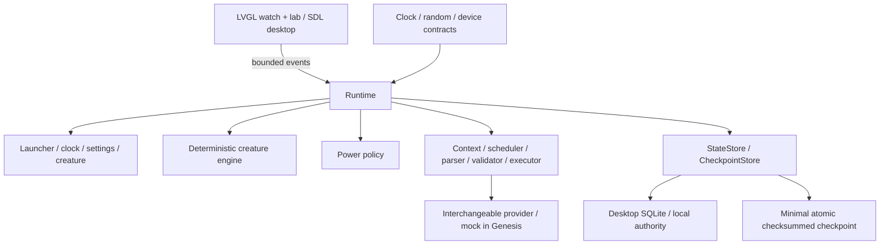

# Architecture

Genesis is a vertical slice of a wearable environment. FreeRTOS/ESP-IDF is the
future embedded kernel/platform; the project does not implement its own kernel.

`daemon_core` is platform-neutral. `daemon_desktop` implements POSIX checkpoint
durability, native SQLite and virtual clocks. `daemon_sim` owns SDL and LVGL.
UI presentation is outside the portable core; a later shared LVGL presentation
library will allow reuse on embedded displays without importing SDL into core.
There is exactly one LVGL execution context with two displays, not one UI thread
per window. The separate debug display is never part of the watch framebuffer.

The runtime owns applications and its event bus; navigation and subscriptions
are destroyed first. The service registry borrows live runtime dependencies.
There is one owner thread for state, persistence and LVGL. No workers, ISRs,
network callbacks or timers mutate state concurrently. The event bus is not a
cross-thread queue. Future FreeRTOS tasks must use a bounded platform queue and
deliver to the owning runtime task.

Every frame processes elapsed monotonic time, then bounded queued events, one
provider chunk and power/persistence policy. Wall time is used only for boot
catch-up and experience timestamps. A wall-clock correction cannot freeze or
fast-forward live needs. Minute quanta and a persisted remainder make update
partitioning deterministic. Offline catch-up is clamped to seven days, negative
wall deltas are ignored, and the new wall baseline is persisted. Age has minute
resolution. Clock trust and authenticated RTC correction are later work.

Applications are static modules with start/resume/pause/stop and a bounded
navigation stack. Existing entries cannot be pushed twice. Launcher remains
the root, and back resumes the previous module. The creature simulation continues
when another app is foreground or the display is virtually asleep. Settings
and vital state persist through the same store interface. Capabilities currently
guard cognitive presentation and memory proposals; full per-app sensor/storage
resource leases are a later framework milestone.

The instinctive engine maintains hunger, energy, health, happiness, affection,
boredom, stress, curiosity, sleep and age. It autonomously sleeps on exhaustion
and wakes when energy recovers. Movement, feeding and affection are deterministic
local interactions. Health does not imply permanent creature death in Genesis.
Personality values persist but personality evolution is not implemented yet.

The mock cognitive provider streams at most 24 bytes per poll. Context includes
identity, current needs, personality and at most eight memories, never complete
history. Prompt composition is currently part of `ContextBuilder`; personality
evolution and separate prompt/personality engines are deferred. No HTTP adapter
is implemented. `speak` updates a text bubble, not an audio device. `remember`
creates a locally validated proposal and enters the same transactional queue.
Animation requests are validated and stored by the executor; renderer behavior
currently follows local sleep/idle state rather than provider animation requests.

The power policy represents deep sleep, BLE standby, interactive, listening,
thinking, speaking and charging. Listening/speaking are reserved states; no audio
pipeline enters them. At 60 seconds idle the display dims to zero; a virtual
connection selects BLE standby. Battery <=5% chooses deep sleep unless charging.
This does not suspend the host or measure current. Rendering uses LVGL dirty
regions; the awake sprite animates at about 4.5 updates/s. A sleeping sprite is
static. Desktop event polling is 16 ms; embedded scheduler optimization is pending.

Implemented system services: bounded bus, registry, state store, cognition,
power policy and a tested bounded one-shot scheduler primitive. Runtime save
cadences currently use direct monotonic deadlines. Full audio, Bluetooth,
networking, sensor supervision, resource leases, logging sinks and update services
are planned, not stubbed as completed subsystems. Desktop lifecycle logs are
structured JSON and do not contain conversations or credentials.
