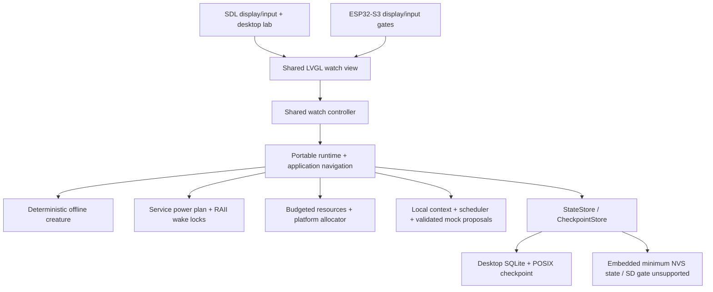

# Habitat architecture

DæmonOS owns local identity, memory, personality, body state and orchestration.
The familiar is a system application. FreeRTOS/ESP-IDF supplies the embedded
kernel; neither a custom kernel nor a mandatory backend is introduced.

`daemon_core` has no LVGL, SDL, SQLite or ESP-IDF imports. `daemon_presentation`
contains the actual watch view, read-only state projection and event controller.
Desktop and firmware link those same sources. The 410 × 502 watch layout is no
longer duplicated in the simulator. SDL and the developer lab remain desktop
adapters; FreeRTOS/NVS/ESP allocators and physical denial gates are embedded.
The replaceable sprite is compiled from the same original palette source.

A single owning thread/task controls state, store access and LVGL. SDK interrupts
and future workers deliver bounded value events through the platform handoff
queue. The core event bus is intentionally not cross-thread safe. Registries
borrow service/application references; navigation and subscriptions die before
those owners. Static application lifecycle is start/resume/pause/stop, with
foreground suspension controlled centrally by power policy.

Platforms ask for the next deadline and block. While awake, interactions and
minute simulation deadlines materialize elapsed needs; while suspended, the
runtime remains quiescent until an event or explicit scheduled task. Wake applies
elapsed monotonic time once, including the persisted minute remainder. Boot uses
wall time with backward-delta rejection and a seven-day cap. Unknown technical
reboots/depleted battery preserve departure health. Time beyond the cap is still
discarded, and physical RTC trust is not qualified yet.

Resource reservations and real platform allocations share bounded pool/category
accounting. Wake locks identify their service, resources and deadline; transitions
invoke service callbacks. Storage work, scheduled callbacks and cognition declare
consumers. The watch pauses its refresh and pointer-read timers and explicitly
renders changed regions. Input/state changes, low-rate idle animation and clock
boundaries request refresh; asleep updates do not render. The lab samples at 2 Hz
and is not part of the firmware image.

The mock uses bounded incremental chunks and an authorized request lifecycle.
The watch builds context from local agent guidance, identity/personality, body,
emotional state, trigger and <=8 selected memories. Response v2 permits silence
and proposes face, animation, voice, actions, memories, personality deltas and
intentions. Unknown/malformed/oversized data fail before effects. Creature
capabilities currently allow text/animation/memory only; personality and intention
execution wait for Awakening. Speech updates text, not a physical audio driver.

SQLite desktop remains the complete local authority and correctness environment.
The firmware links SQLite with a fixed heap and a persistent-file denial VFS;
NVS A/B records retain only minimum state/settings. No FatFS locking, MicroSD
history or physical durability is claimed. Drivers, authenticated transports,
real inference, speech and OTA remain separate future work.
